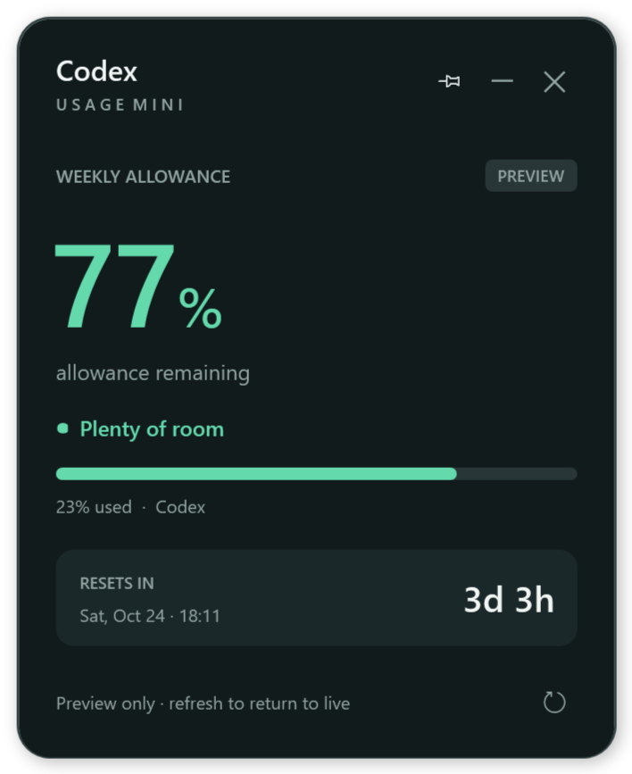

# Codex Usage Mini

A small Windows desktop widget for the Codex allowance on your signed-in ChatGPT account.



## Run

1. Install Codex for Windows (desktop app or native CLI) and sign in with your ChatGPT account.
2. Open `dist\CodexUsageMini.exe`, or extract the portable ZIP and open `CodexUsageMini.exe` next to its `.config` file.
3. The widget reads your allowance automatically and refreshes every 60 seconds. No API key is needed.

Windows 10/11 with .NET Framework 4.8 is required. The app uses native WPF; no browser, Node.js, Python, or .NET SDK is needed to run or build it.

## Colors

| Allowance remaining | Color |
| --- | --- |
| More than 50% | Green |
| 10% through 50%, including both boundaries | Orange |
| Less than 10% | Red |
| Missing, outdated, reset pending, or connection failed | Gray / unknown |

The large number shows the most restrictive reported allowance window. When Codex reports several windows or buckets, the other windows appear below it. A reported usage block is shown in red even if a percentage remains. Missing values are never interpreted as a full allowance. Times use your Windows local timezone.

This is an allowance percentage, not an estimate of tokens left. OpenAI reports `usedPercent`, `windowDurationMins`, and `resetsAt`; converting that quota into a remaining token count would be misleading.

## Controls

- Drag the **Codex / Usage Mini** heading to move the widget.
- **Pin** toggles always on top. It starts pinned.
- **Minus** or **Esc** hides the widget to the Windows system tray. Double-click its tray icon to show it again.
- **Refresh** or **F5** fetches the current allowance. Refresh also exits color preview mode.
- Right-click the widget or tray icon for **Preview colors**, refresh, pin, and quit.
- **X** quits, including the tray icon.
- Launching the app again brings the existing widget back.

The tray ring uses the same colors and displays the percentage (rounded down to a whole number). A stale reading uses a gray question mark. Windows may initially place the tray icon under its overflow arrow.

## Privacy and data connection

The widget starts a local `codex app-server --listen stdio://` subprocess for each refresh. It sends only `initialize`, `initialized`, and `account/rateLimits/read`, then closes that subprocess. It does not create chats, run model turns, consume earned resets, or start a web listener. Codex handles the existing sign-in. The widget does not read, copy, or export your auth files, and it never logs raw upstream output or saves allowance readings.

Only window position and pin preference are saved. On this computer the default is `E:\Users\<username>\AppData\Local\CodexUsageMini` when that profile exists; other computers use `%LOCALAPPDATA%\CodexUsageMini`. Set `CODEX_USAGE_MINI_DATA` to choose another preferences directory.

The app discovers the installed desktop `codex.exe`, then native executables on PATH, then npm's bundled native executable. Set `CODEX_USAGE_MINI_CODEX` to the full path of `codex.exe` to override discovery. It deliberately does not execute `.cmd` or shell strings.

The protocol is documented in [OpenAI's Codex App Server reference](https://developers.openai.com/codex/app-server/), under **Rate limits (ChatGPT)**. This is an independent utility and is not an official OpenAI application. App-server availability and response fields depend on the installed Codex version and account.

## Build and verify

From the project directory:

```powershell
powershell -NoProfile -ExecutionPolicy Bypass -File .\build.ps1 -Test
.\dist\CoreTests.exe --live-check
.\dist\CodexUsageMini.exe --smoke .\docs
```

The build uses Windows' .NET Framework compiler and installs no packages. `-Test` runs 40 deterministic checks, including exact thresholds, missing/null fields, clamping, primary/secondary and multiple buckets, stale resets, the JSON-RPC handshake, errors, timeout, and cancellation. The optional live check requires a signed-in Codex account. `--smoke` runs native UI checks and renders synthetic screenshots without a network connection or saving preferences.

For an interactive offline preview:

```powershell
.\dist\CodexUsageMini.exe --demo 35
```

To produce the portable ZIP:

```powershell
powershell -NoProfile -ExecutionPolicy Bypass -File .\package.ps1
```

## Project

- `src/UsageModel.cs`: quota parsing, thresholds, reset and freshness rules.
- `src/CodexClient.cs`: local Codex discovery and read-only JSON-RPC client.
- `src/App.cs`: native widget, tray, preferences, and UI smoke checks.
- `tests/CoreTests.cs`: deterministic model and subprocess protocol checks.
- `.github/workflows/build.yml`: Windows build and test workflow, ready for GitHub after review.

`docs/preview-*.png` use synthetic data only. Generated binaries, local preferences, test artifacts, and archives are excluded from Git.
