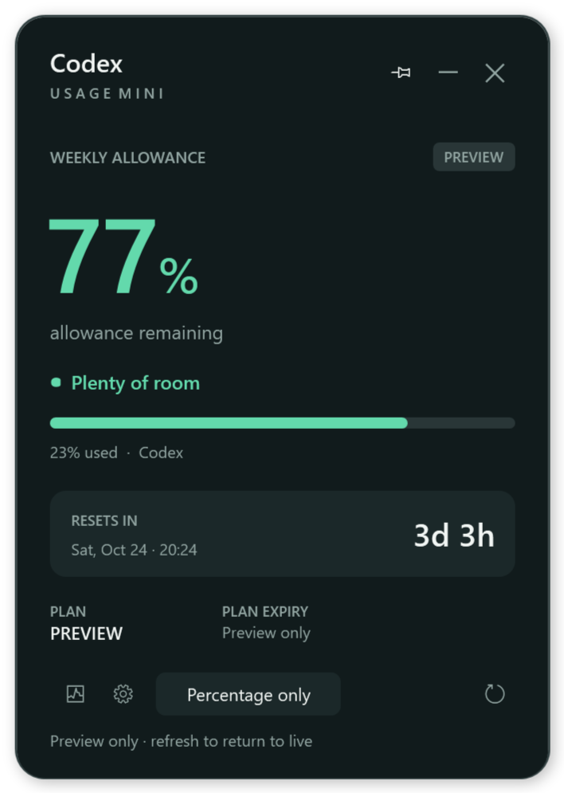
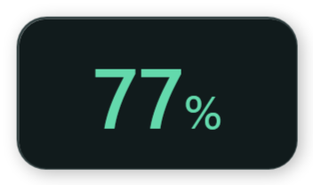
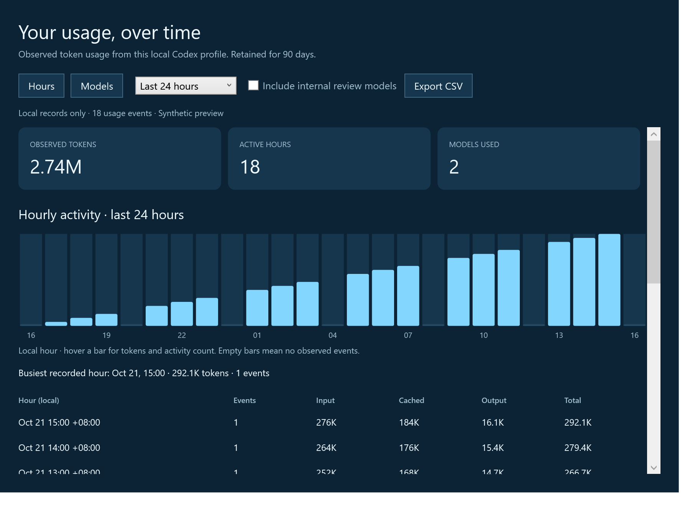
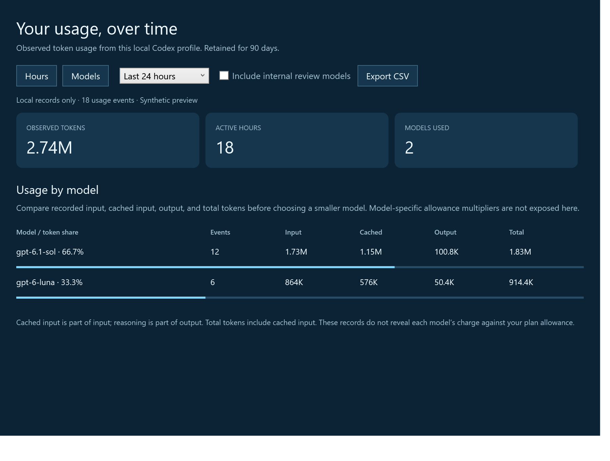
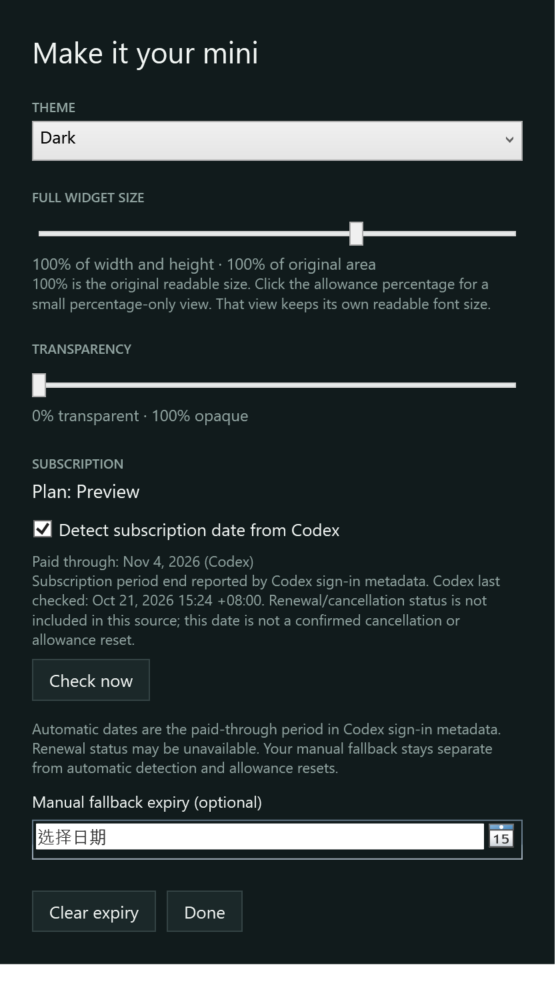

# Codex Usage Mini

A small Windows widget for Codex allowance, with private hourly history and model usage statistics.



Click **Percentage only** beside the gear to collapse to a readable percentage-only window. Hover over the small window and click **↗** to expand it again. Clicking the percentage also switches views.



## Run

[Download the v0.2.0 portable Windows app](https://github.com/shengyi725/codex-usage-mini/releases/download/v0.2.0/CodexUsageMini-v0.2.0-portable.zip).

Install Codex for Windows (desktop app or native CLI), sign in with your ChatGPT account, then open `dist\CodexUsageMini.exe`. For a portable build, extract `CodexUsageMini-v0.2.0-portable.zip` and open the executable next to its `.config` file. No API key or installer is needed.

Requires Windows 10/11 and .NET Framework 4.8. The app uses native WPF and Windows' built-in .NET Framework compiler. No browser, Node.js, Python, or .NET SDK is needed to run or build it.

## Allowance and subscription

| Allowance remaining | Display |
| --- | --- |
| More than 50% | Green |
| 10% through 50%, inclusive | Orange |
| Less than 10% | Red |
| Missing, stale, reset pending, or connection failed | Gray / unknown |

The widget refreshes every 60 seconds. The large number shows the lowest remaining reported window, with additional windows below it. Allowance is a percentage; it is not converted into an invented count of remaining tokens. Failed refreshes never turn missing data into a full allowance.

**Plan** displays the plan name supplied by Codex. A saved name is labeled **last known** when a fresh reading is unavailable.

**Paid through** is detected automatically from the subscription metadata in Codex's existing local sign-in. It uses the explicit subscription `active_until` date and verifies that the selected sign-in account matches the allowance account when its identity is available. It never uses authentication-token expiry or allowance reset timestamps as the plan date.

Open **Appearance and plan** for the detection switch, **Check now**, and the time Codex last checked the subscription. The widget rereads local metadata every minute; Codex itself refreshes that metadata. A check time older than three days, an unknown check time, or a past period end is labeled **last known**. The source does not include automatic-renewal or cancellation status, so **Paid through** means the reported subscription-period end rather than a confirmed termination date.

A manually entered **Plan expiry** remains a separate fallback, labeled `(entered)`, and is never overwritten by detection. If the metadata is missing, unreadable, or unsupported, the fallback is used. Conflicting account identities hide subscription dates until the accounts match. File-based ChatGPT sign-in is required for detection; secure-store-only and API-key sign-ins may not provide the date. The full Billing endpoint is not used because it rejected the CLI credential in compatibility testing.

## Hourly and model history

Click the history icon, or right-click and choose **Hourly usage and models**.

- **Hours:** tokens and usage-event frequency by hour, active-hour count, peak hour, and an hourly table. The 24-hour view includes partial starting/ending hours. For 7-, 30-, and 90-day ranges, the chart shows the hour-of-day pattern across that range.
- **Models:** recorded input, cached input, output, total tokens, event counts, and each model's share of observed tokens.
- **Internal review models:** hidden by default and available through an explicit checkbox.
- **Export CSV:** saves hourly totals by model for the full selected range, using both local and UTC timestamps.





Statistics use the existing local `sessions` and `archived_sessions` logs under `CODEX_HOME` (or `~/.codex`). Existing available history is imported in the background and new records are checked every minute. Up to 90 days of counters are retained, including across restarts. Activity from other devices and cloud-only sessions is outside this view. Empty bars mean no **observed** events; they do not prove inactivity.

Where available, per-response `token_usage_record` entries take precedence. Older files use differences between cumulative token counters, with duplicate protection. The importer does not mix diverging UI counters into an existing per-response stream. Model changes, incomplete trailing lines, copied/archived logs, counter resets, and incremental restarts are handled explicitly.

Cached input is included in input; reasoning is included in output. Neither is added to total a second time. These are observed tokens, **not per-model subscription-quota charges**. The quota endpoint does not provide model multipliers that would support a reliable downgrade-savings estimate.

## Appearance

Click the gear or choose **Appearance and plan** from the widget or tray menu.

- **Views:** full details at the original 100% size, or a small percentage-only window with its own readable 48-point number. Click the percentage or press **Ctrl+M** to switch.
- **Full widget size:** optional 50–125% scaling for fonts, bars, icons, and spacing in the full view. Compact text keeps its own size.
- **Transparency:** 0–50%, corresponding to 100–50% opacity. Settings and history remain readable at normal window size.
- **Themes:** Daylight, Dark, Ocean, and Forest.
- **Subscription:** automatic Codex paid-through detection, source check time, a Check now button, and an editable manual expiry fallback.



## Controls

Click **Percentage only** beside the gear to switch to the smaller view. Hover over that view and click **↗** to restore the full widget. Clicking the percentage or pressing **Ctrl+M** also switches views. Drag the heading in the full view, or drag the percentage in the compact view, to move it; dragging does not expand it.

In compact view, hover or use Tab to reveal the **↗** expand button and **…** options button. It opens the full-size menu for history, appearance, and other controls. History and settings open in separate windows only when requested. Right-click also opens the menu.

Pin toggles always on top. Minus or Esc hides to the tray; double-click its icon to restore. Refresh or F5 refreshes allowance and exits color preview mode. X quits the widget and its owned windows. Launching it again restores the existing instance. The tray menu remains full size when the widget is small.

Right-click **Preview colors** for synthetic green/orange/red examples. History and appearance are also accessible from the tray. Changes to view, appearance, size, transparency, and plan expiry persist locally.

## Privacy and local files

The allowance connection starts a local `codex app-server --listen stdio://` subprocess and sends only `initialize`, `initialized`, and `account/rateLimits/read`. It creates no chats, runs no model turns, consumes no earned resets, and starts no web listener. Codex handles the allowance sign-in; upstream diagnostics are discarded.

When subscription detection is enabled, the widget also reads `CODEX_HOME/auth.json` (or `~/.codex/auth.json`) to decode the existing ID token's subscription metadata. It uses only subscription dates, the source check time, plan type, and account matching. It does not use access/refresh tokens, browser cookies, or passwords; it sends no billing requests, verifies no JWT signatures, and never uses decoded metadata as authorization. No tokens or raw account identifiers are saved, logged, exported, or included in the portable package. The detected snapshot stays in memory; disabling detection stops this file read.

Local history retains timestamps, model names, numeric counters, and hashed event/cursor identities. Prompts, chat messages, tool output, project paths, raw response/thread identifiers, and credentials are not saved in the history database. Statistics and entered expiry dates are never uploaded automatically or included in the portable package.

Data files are `preferences.json` and `usage-history.json`, with atomic writes and backups. The default folder is `E:\Users\<username>\AppData\Local\CodexUsageMini` when that profile exists; otherwise it is `%LOCALAPPDATA%\CodexUsageMini`. Set `CODEX_USAGE_MINI_DATA` to use another directory. Private runtime data and personal exports are excluded from Git.

The app discovers a desktop installation's `codex.exe`, then native executables on PATH, then npm's bundled executable. Set `CODEX_USAGE_MINI_CODEX` to a full `.exe` path to override it. Shell strings and `.cmd` files are not executed.

The allowance protocol is documented in [OpenAI's App Server reference](https://developers.openai.com/codex/app-server/). Local log formats can vary with Codex versions; missing fields remain unknown. This is an independent utility, not an official OpenAI app.

## Build and verify

Quit the running widget before rebuilding its executable.

```powershell
powershell -NoProfile -ExecutionPolicy Bypass -File .\build.ps1 -Test
.\dist\CodexUsageMini.exe --smoke .\docs
```

The deterministic suite runs 103 checks covering allowance thresholds, protocol failures/cancellation, token accounting, mixed log formats, duplicate/copy protection, partial writes, counter resets, history persistence, UTF-8, retention, theme/appearance limits, and account-bound plan expiry. Native smoke checks render all themes, hourly/model views and settings, and verify automatic subscription presentation, compact colors/stale state, a fixed readable compact size, click-to-expand restoration, proportional full-view scaling, opacity, pinning, hiding, and restoring. Screenshots use synthetic data and test runs do not alter personal settings.

Optional live checks:

```powershell
.\dist\CoreTests.exe --live-check
.\dist\CoreTests.exe --history-live-check
.\dist\CoreTests.exe --subscription-live-check
```

The allowance check needs a working signed-in Codex service. The history check imports one bounded batch of private local counters. History remains available when the allowance service is offline. The subscription check validates the local provider independently of the entered fallback.

For an interactive synthetic preview:

```powershell
.\dist\CodexUsageMini.exe --demo 35
```

To build, test, and package the portable ZIP:

```powershell
powershell -NoProfile -ExecutionPolicy Bypass -File .\package.ps1
```

Source modules live in `src/`; tests live in `tests/`. `.github/workflows/build.yml` builds, tests, and attaches the portable package on Windows.
